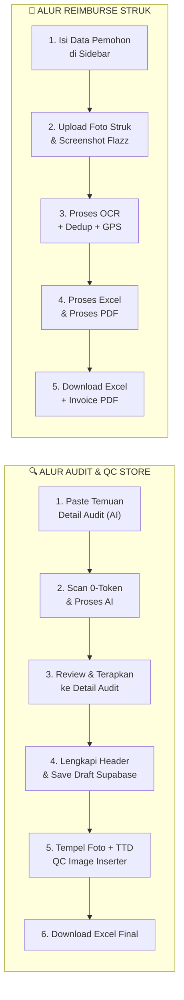

<div align="center">


</div>

Panduan lengkap penggunaan aplikasi **Teazzi Audit & QC Toolkit**, pengelolaan provider AI (tambah/edit/hapus), kustomisasi template & checklist, konfigurasi Supabase/Secrets, hingga troubleshooting error umum.

> [!TIP]
> Panduan ringkas interaktif juga tersedia langsung di dalam aplikasi melalui sidebar halaman **`9_Panduan` (📖 Panduan & Docs)**.

---

## 📑 Daftar Isi

1. [Alur Kerja Utama (Quick Start)](#-1-alur-kerja-utama-quick-start)
2. [Panduan Penggunaan Tiap Halaman (1–8)](#-2-panduan-penggunaan-tiap-halaman-18)
   * [Halaman 1 — Detail Audit (AI)](#halaman-1--detail-audit-ai-pages1_detail_audit_llmpy)
   * [Halaman 2 — Detail Audit Manual](#halaman-2--detail-audit-manual-pages2_detail_auditpy)
   * [Halaman 3 — QC Image Inserter](#halaman-3--qc-image-inserter-pages3_qc_image_inserterpy)
   * [Halaman 4 — Cek Model AI](#halaman-4--cek-model-ai-pages4_cek_model_aipy)
   * [Halaman 5 — Reimburse Scanner](#halaman-5--reimburse-scanner-pages5_reimburse_scannerpy)
   * [Halaman 6, 7, 8 — Admin Data, Audit Log, Traffic Log](#halaman-6-7-8--admin-data-audit-log--traffic-log)
3. [Tips Hemat Token & Upload Foto dari HP](#-3-tips-hemat-token--upload-foto-dari-hp)
4. [Cara Menambah, Mengedit, & Menghapus Provider AI](#-4-cara-menambah-mengedit--menghapus-provider-ai)
   * [Cheat Sheet 4 File](#cheat-sheet-4-file)
   * [Cara Menambah Provider Baru (OpenAI-Compatible)](#cara-menambah-provider-baru-openai-compatible)
   * [Cara Menghapus Provider Lama](#cara-menghapus-provider-lama)
   * [Pakai BYOK Tanpa Mengubah Kode](#pakai-byok-tanpa-mengubah-kode)
   * [Aturan Khusus Provider 9router](#aturan-khusus-provider-9router)
5. [Kustomisasi Checklist, Skor, Template Excel, Preset & Tema](#-5-kustomisasi-checklist-skor-template-excel-preset--tema)
6. [Setup Secrets, Supabase, & Keep-Alive](#-6-setup-secrets-supabase--keep-alive)
7. [Troubleshooting & FAQ](#-7-troubleshooting--faq)

---

## 🚀 1. Alur Kerja Utama (Quick Start)

Aplikasi ini terdiri dari **2 alur operasional terpisah**:



---

## 📖 2. Panduan Penggunaan Tiap Halaman (1–8)

### Halaman 1 — Detail Audit (AI) (`pages/1_Detail_Audit_LLM.py`)

Mengubah catatan temuan lapangan yang tidak rapi menjadi pemetaan ke **130 item checklist resmi**.

1. **Pilih Provider** (`1. Pilih Provider`) — misalnya `Kagiro Proxy`, `Juan Proxy`, `9router Proxy`, `DeepSeek (Direct)`, `Gemini (Direct)`, atau `BYOK (Custom)`.
2. **Klik `🔍 Scan` (0 token)** untuk memuat seluruh daftar model asli (`raw ID`) dari server provider ke dropdown `2. Pilih Model AI`.
   * Tidak mengirim request completion apa pun, sehingga **tidak membakar token**.
3. *(Opsional)* **Klik `🩺 Test`** untuk menguji satu per satu model mana yang hidup + mengukur latensi (detik):
   * Dropdown otomatis tersaring agar **hanya menampilkan model yang hidup**, diurutkan dari latensi tercepat.
   * Muncul ringkasan **Total / ✅ Aktif / ❌ Error** + toggle `📋 Tampilkan Detail Hasil Test Model`.
   * **Shared Cache lintas tab & lintas device**: hasil Scan/Test tersimpan di server (`@st.cache_resource`), sehingga jika dibuka dari tab baru atau HP/laptop lain, daftar model hidup langsung tampil tanpa perlu Test ulang.
4. **Paste catatan temuan** pada kolom teks, lalu klik **`🤖 Proses dengan AI`**.
5. **Review hasil**:
   * Periksa bagian `⚠️ Temuan yang Tidak Masuk Box Checklist` (`unmatched`) jika ada catatan yang tidak cocok ke checklist mana pun (bisa di-download sebagai `.txt`).
   * Pada `📝 Review Usulan AI`, centang/lepas centang item atau edit kalimat remarks seperlunya.
6. Klik **`✅ Terapkan ke DETAIL AUDIT (draft baru)`** → otomatis berpindah ke halaman `2_Detail_Audit` dengan seluruh remarks terisi.

> [!IMPORTANT]
> Menekan **Terapkan ke DETAIL AUDIT (draft baru)** akan mengganti isian aktif di halaman `Detail Audit` dengan draft baru. Pastikan draft sebelumnya sudah disimpan ke Supabase bila masih dibutuhkan.

---

### Halaman 2 — Detail Audit Manual (`pages/2_Detail_Audit.py`)

Mengisi atau menyempurnakan form 130 checklist, melihat skor real-time, menyimpan draft ke cloud, dan mengunduh workbook Excel.

1. **Buka Draft Lama (opsional)**: buka expander `📂 Buka data toko yang tersimpan`, pilih draft, lalu klik **`🔄 Muat Draft`**.
   * Mendukung link langsung lewat URL query: `?store=NamaToko&date=Tanggal`.
2. **Isi Header**: `STORE NAME`, `DATE`, `DATE (2)`, `AUDITOR`, dan `PIC ON DUTY`.
3. **Isi Remarks**: ketik temuan pada kolom `Remarks` item yang melanggar.
   * **Aturan Skor**: jika `Remarks` diisi → `Actual Score` item itu otomatis menjadi **`0`**; jika kosong → mendapat nilai penuh (`Basic`).
   * Pengecualian sesuai rumus Excel: item **#58 (Putar musik)** tidak masuk perhitungan skor.
4. **Pantau Skor & Grade Real-Time**:
   * Bobot kelompok: **SERVICE (30%)**, **FOOD SAFETY (40%)**, **CLEANLINESS (30%)**.
   * Grade: `>= 96` **A** | `>= 91` **B+** | `>= 86` **B** | `>= 81` **B-** | `< 81` **C**.
5. **Simpan / Update / Download**:
   * Gunakan **tombol melayang kiri bawah**: `💾` untuk *Save draft* ke Supabase, `⬇️` untuk *Download Excel*.
   * Jika sedang mengedit draft yang dimuat dan ingin **mengganti Store Name / Date tanpa membuat baris duplikat**, gunakan tombol **`✏️ Update Draft Ini`** di expander atas.
   * Gunakan tombol panah kanan atas/bawah (`▲` / `▼`) untuk lompat cepat ke atas atau bawah halaman.

---

### Halaman 3 — QC Image Inserter (`pages/3_QC_Image_Inserter.py`)

Menyusun puluhan/ratusan foto QC ke sheet `ATTACHMENT` dan menambahkan tanda tangan digital.

1. **Isi Nama Pengguna** di bagian atas.
2. **Pilih Sumber Template Excel**:
   * **`Dari Draft DETAIL AUDIT` *(Rekomendasi)***: otomatis mengambil seluruh nilai & remarks dari draft Supabase, header langsung terisi.
   * **`File Preset`**: memilih template dari folder `presets/`.
   * **`Upload Manual`**: mengunggah file `.xlsx` sendiri.
3. **Pengaturan Layout**: biarkan `Default` (6 kolom `A–F`, otomatis tambah baris tanpa batas jika foto melebihi slot awal) atau pilih `Custom`.
4. **Pengesahan Form QC (Tanda Tangan)**: unggah foto tanda tangan **Auditor** & **PIC** (otomatis ditempel di `A166` / `D166` + nama di `A167` / `D167`, bisa diubah lewat mode `Custom`).
5. **Upload Foto QC**: pilih semua foto sekaligus (otomatis diurutkan berdasarkan timestamp nama file, dikoreksi orientasi EXIF, dan dikompres JPEG 1280px).
6. Klik **`MULAI EXPORT DAN PROSES DATA`**, tunggu progress bar selesai, lalu klik **`DOWNLOAD FILE EXCEL`**.

---

### Halaman 4 — Cek Model AI (`pages/4_Cek_Model_AI.py`)

Alat diagnostik independen untuk mengecek kesehatan provider, API key (dari Secrets atau input manual BYOK), dan kecepatan respons model.

1. Pilih preset provider (atau `Custom / Manual Input (BYOK)`).
   * API Key yang sudah ada di Secrets **tidak ditampilkan secara polos** (hanya placeholder `•••••••• [Terisi dari Secrets]`).
2. Klik **`🔍 Auto-Scan Daftar Model`** untuk melihat daftar model aktif dari `/models`.
3. Klik **`🩺 Tes Kesehatan Semua Model Hasil Scan`** untuk melihat mana model yang hidup beserta latensinya dan mana yang error.

---

### Halaman 5 — Reimburse Scanner (`pages/5_Reimburse_Scanner.py`)

Mengekstrak foto struk bulanan (bensin, parkir, Teazzi/minuman) & screenshot Flazz/BCA menjadi Excel kronologis + PDF bukti lossless.

1. **Sidebar Data Pemohon**: periksa/isi `Name`, `Department`, `Purpose`, `Bank Acc.` (otomatis terisi dari `DEFAULT_*` di secrets jika diset).
2. **Pilih Provider & Model Vision**:
   * Mode default **`Vision saja (rekomendasi OCR)`** menyaring model non-vision (embedding/tts/rerank). Gunakan **`Semua model dari server`** bila model yang dicari tidak muncul.
   * Buka expander **`💡 Konsumsi token per gambar`** untuk referensi model paling hemat.
   * Gunakan **`🩺 Cek API hidup`** jika ingin ping manual 1 model terpilih sebelum memproses banyak struk.
3. **Unggah Bukti**:
   * Kiri: foto struk fisik (Bensin, Parkir, Teazzi).
   * Kanan: screenshot mutasi Flazz / e-money *(opsional)*.
4. Klik **`🚀 Mulai Proses OCR, Sorting, Generate Excel & PDF`**:
   * Sistem otomatis mengekstrak tanggal, jam, kategori, deskripsi, nominal; mencari nama lokasi parkir dari **EXIF GPS** jika tidak tertulis di struk; membuang baris **Top Up**; serta **deduplikasi** transaksi parkir Flazz yang sudah ada struk fisiknya atau tumpang tindih antar-screenshot.
5. **Proses & Unduh (2 Tahap)**:
   * Klik **`📊 Proses Excel`** → muncul **`📥 Download Excel Reimburse`** (`Reimburse [Bulan] [Tahun].xlsx`).
   * Klik **`🧾 Proses PDF`** → muncul **`📥 Download PDF Bukti Gabungan`** (`Invoice [Bulan] [Tahun].pdf`, tanpa kompresi/downsizing).
   * Urutan halaman PDF: *Struk fisik kronologis → Screenshot Flazz → Foto yang gagal di-OCR (jika ada)*.

---

### Halaman 6, 7, 8 — Admin Data, Audit Log, & Traffic Log

| Halaman | Password Secret | Fungsi |
|---|---|---|
| `6_Admin_Hapus_Data.py` | `ADMIN_PASSWORD` | Filter draft, edit metadata (`Store Name`, `Date`, `Auditor`), hapus draft satuan, atau hapus semua draft (wajib ketik `HAPUS`). |
| `7_Audit_Log.py` | `TRAFFIC_LOG_PASSWORD` | Melihat riwayat `Save`, `Download`, `Update` (timestamp WIB), filter, serta hapus log satuan/semua. |
| `8_Traffic_Log.py` | `TRAFFIC_LOG_PASSWORD` | Tampilan *read-only* riwayat pemakaian aplikasi dari tabel `audit_traffic_log`. |

---

## 💡 3. Tips Hemat Token & Upload Foto dari HP

### Hemat Token AI
* Di `1_Detail_Audit_LLM.py`, **cukup klik `🔍 Scan` (0 token)** lalu langsung pilih model yang sudah kamu kenal hidup.
* Gunakan **`🩺 Test`** hanya saat provider baru ditambahkan atau banyak model sedang gangguan — hasilnya otomatis tersimpan lintas tab & lintas device sehingga tim lain tidak perlu mengetes ulang.
* Di `5_Reimburse_Scanner.py`, pilih model vision dengan konsumsi token rendah (cek tabel *Konsumsi token per gambar* di halaman tersebut) saat memproses puluhan struk sekaligus.

### Upload Foto QC dari HP
* Gunakan **Gallery bawaan HP** atau **File Manager**, hindari memilih langsung dari *Google Photos* karena koneksi upload sering terputus saat mengunduh foto cloud.
* Jika sempat muncul *reconnecting*, tunggu beberapa detik lalu ulangi upload atau tekan tombol **`Hapus Semua Foto (Reset)`**.

---

## 🔌 4. Cara Menambah, Mengedit, & Menghapus Provider AI

### Cheat Sheet 4 File

Jika ingin menambahkan atau menghapus provider AI agar sinkron di **seluruh halaman**, hanya ada **4 tempat** yang perlu disentuh:

| # | Lokasi | Modul yang Terdampak |
|:-:|---|---|
| 1 | `.streamlit/secrets.toml` *(atau Streamlit Cloud Secrets)* | Menyimpan API Key & Base URL rahasia |
| 2 | `llm_core.py` | `Detail Audit (AI)` — Scan, Test, & Mapping |
| 3 | `reim_llm_core.py` | `Reimburse Scanner` — Vision OCR |
| 4 | `pages/4_Cek_Model_AI.py` | `Cek Model AI` — Preset diagnostik |

---

### Cara Menambah Provider Baru (OpenAI-Compatible)

Misalnya kamu ingin menambah provider bernama **`NovaAI`** dengan endpoint `https://api.novaai.id/v1` dan prefix secret `NOVAAI`:

#### Langkah 1 — Tambahkan Secret (`.streamlit/secrets.toml` & Streamlit Cloud Secrets)
```toml
NOVAAI_API_KEY = "sk-isi-api-key-kamu"
# Opsional, hanya jika URL ingin diatur dari secrets (tidak di-hardcode):
# NOVAAI_BASE_URL = "https://api.novaai.id/v1"
```

#### Langkah 2 — Daftarkan di `llm_core.py`
1. Tambahkan nama ke `PROVIDER_LIST`:
```python
PROVIDER_LIST = [
    ...
    "NovaAI Proxy",
    "BYOK (Custom)",
]
```
2. Tambahkan ke `_GENERIC_GATEWAYS` *(format: `"Nama Provider": ("PREFIX_SECRET", "https://base-url/v1")`)*. Isi `""` jika URL diambil dari `<PREFIX>_BASE_URL` di secrets:
```python
_GENERIC_GATEWAYS = {
    ...
    "NovaAI Proxy": ("NOVAAI", "https://api.novaai.id/v1"),
}
```
3. Tambahkan minimal 1 model default ke `FALLBACK_MODELS` *(pakai **raw ID** murni)*:
```python
FALLBACK_MODELS = {
    ...
    "NovaAI Proxy": {
        "deepseek-v4.1-flash": {
            "provider": "novaai",
            "model": "deepseek-v4.1-flash",
        },
    },
}
```
> [!NOTE]
> `_PREFIX_TO_GATEWAY`, `scan_provider_models()`, `ping_provider_model()`, dan `call_llm()` di `llm_core.py` **otomatis mengenali** semua entri baru di `_GENERIC_GATEWAYS` tanpa perlu menambah fungsi baru.

#### Langkah 3 — Daftarkan di `reim_llm_core.py` *(untuk Reimburse Scanner)*
Tambahkan 1 baris di `_PROVIDER_DEFS`:
```python
_PROVIDER_DEFS = [
    ...
    ("NovaAI", "NOVAAI", "https://api.novaai.id/v1"),
]
```
*(Jika provider punya model fallback khusus saat `/models` gagal, tambahkan juga di `_PROVIDER_EXTRA_FALLBACK`.)*

#### Langkah 4 — Daftarkan di `pages/4_Cek_Model_AI.py` *(untuk Cek Model AI)*
Tambahkan ke `PRESET_PROVIDERS`:
```python
PRESET_PROVIDERS = {
    ...
    "NovaAI": {
        "url": "https://api.novaai.id/v1",
        "secret": "NOVAAI_API_KEY",
    },
}
```

---

### Cara Menghapus Provider Lama

Lakukan kebalikannya agar bersih tanpa sisa:

1. **Hapus dari `llm_core.py`**:
   * Hapus namanya dari `PROVIDER_LIST`.
   * Hapus dari `_GENERIC_GATEWAYS` *(atau cabang khusus di `_get_provider_connection` & `call_llm` bila provider tersebut Kagiro/Bandel/DeepSeek/Gemini)*.
   * Hapus entrinya dari `FALLBACK_MODELS` dan alias terkait di `_PREFIX_TO_GATEWAY` (jika ada).
2. **Hapus dari `reim_llm_core.py`**:
   * Hapus barisnya dari `_PROVIDER_DEFS` (dan `_PROVIDER_EXTRA_FALLBACK` jika ada).
3. **Hapus dari `pages/4_Cek_Model_AI.py`**:
   * Hapus entrinya dari `PRESET_PROVIDERS`.
4. **Hapus API Key-nya** dari `.streamlit/secrets.toml` dan **Streamlit Cloud → Settings → Secrets**.

> [!TIP]
> Khusus di `Reimburse Scanner`, jika kamu hanya ingin **menonaktifkan sementara** satu provider tanpa mengedit kode, cukup **hapus atau kosongkan `<PREFIX>_API_KEY`** di secrets — provider otomatis tidak muncul di dropdown Reimburse.

---

### Pakai BYOK Tanpa Mengubah Kode

Kalau hanya ingin mencoba provider sementara tanpa mengedit kode & tanpa deploy ulang:
* Di **`1_Detail_Audit_LLM.py`**: pilih `BYOK (Custom)` → isi `BYOK Base URL` (akhiri `/v1`) dan `BYOK API Key` → klik **`💾 Simpan BYOK`** (otomatis ter-share ke device lain selama server hidup) → klik **`🔍 Scan`** lalu **`🩺 Test`**.
* Di **`4_Cek_Model_AI.py`**: pilih `Custom / Manual Input (BYOK)` → isi URL & API Key → klik **`🔍 Auto-Scan Daftar Model`**.

---

### Aturan Khusus Provider `9router`

* URL `9router` **sengaja tidak di-hardcode** di repo publik agar alamat tunnel internal tetap aman. Wajib diisi di secrets lewat `ROUTER9_BASE_URL` dan `ROUTER9_API_KEY`.
* Model ber-prefix `cbai/*` (mis. `cbai/deepseek-v4.1-flash`) hanya dipasang di fallback `9router` agar tidak bocor ke gateway lain.

---

## ⚙️ 5. Kustomisasi Checklist, Skor, Template Excel, Preset & Tema

### A. Mengubah Checklist Audit (`structure.json` + `template.xlsx` + `scoring.py`)
* Setiap item di `structure.json` memiliki `number`, `row` (nomor baris persis di sheet `DETAIL AUDIT` pada `template.xlsx`), `desc`, dan `basic`.
* **Aturan wajib**: jika menambah/menggeser baris di `template.xlsx`, field `"row"` di `structure.json` **harus ikut diperbarui** agar `audit_core.py` menulis Actual Score (kolom D) dan Remarks (kolom E) ke baris yang benar.
* Jika ada item yang tidak dihitung ke skor (seperti `#58 Putar musik`), tambahkan `"exclude_from_score": true` pada item tersebut.
* Bobot kelompok (`SERVICE: 30`, `FOOD SAFETY: 40`, `CLEANLINESS: 30`) dan ambang batas grade (`A`/`B+`/`B`/`B-`/`C`) diatur di `scoring.py`.

### B. Menambah / Menghapus Preset QC Image Inserter (`presets/`)
* Cukup tambahkan file `.xlsx` baru ke folder `presets/` (atau hapus file lama) — halaman `3_QC_Image_Inserter.py` otomatis membaca seluruh file `.xlsx` di folder tersebut melalui `get_preset_files()`.

### C. Mengganti Template Reimburse (`FORM_REIMBURSE_template.xlsx`)
* Pastikan nama sheet tetap `FORM` (atau ubah `SHEET_NAME` di `reim_excel_core.py`).
* Struktur sel yang dipakai `reim_excel_core.py`:
  * Header pemohon: `C6` (Name), `C7` (Department), `C8` (Purpose), `C9` (Bank Acc).
  * Periode transaksi: `E6` (tanggal transaksi pertama), `E7` (tanggal transaksi terakhir).
  * Baris data mulai `DATA_START_ROW = 12` sampai `DATA_END_ROW_DEFAULT = 61`, baris total `TOTAL_ROW_DEFAULT = 62` (otomatis menyisipkan baris baru jika data > 50 item).
* Logo header dalam bentuk *grouped shape* dipertahankan otomatis oleh `_reinsert_media()` agar tidak hilang saat `openpyxl` menyimpan file.

### D. Mengubah Warna Tema Cyberpunk Neon (`style.py` & `app.py`)
* Palet utama diatur di blok `:root` pada `THEME_CSS` di `style.py`:
  * `--bg: #05050d` (latar utama)
  * `--cyan: #00f0ff` (aksen neon utama)
  * `--magenta: #ff007f` (aksen neon sekunder)
* Styling khusus halaman utama ada di blok `<style>` bagian atas `app.py`, dan styling banner kategori/floating dock audit ada di bagian atas `pages/2_Detail_Audit.py`.

---

## 🔐 6. Setup Secrets, Supabase, & Keep-Alive

### Daftar Lengkap Variabel `.streamlit/secrets.toml`

```toml
# ── Database Supabase ──
SUPABASE_URL = "https://xxxx.supabase.co"
SUPABASE_KEY = "eyJhbGciOi..."

# ── Password Halaman Proteksi ──
ADMIN_PASSWORD = "password-admin-kamu"
TRAFFIC_LOG_PASSWORD = "password-log-kamu"

# ── Provider AI (isi yang dipakai saja) ──
GEMINI_API_KEY = "..."
DEEPSEEK_API_KEY = "..."
KAGIRO_API_KEY = "..."
BANDEL_API_KEY = "..."
CARTRIDGE_API_KEY = "..."
KENARI_API_KEY = "..."
GATEAI_API_KEY = "..."
JUAN_API_KEY = "..."
SEEKAI_API_KEY = "..."
ROUTER9_API_KEY = "..."
ROUTER9_BASE_URL = "https://tunnel-9router-kamu/v1"

# ── Default Pemohon Reimburse (opsional) ──
DEFAULT_NAME = "Nama Pemohon"
DEFAULT_DEPARTMENT = "Quality Control"
DEFAULT_PURPOSE = "Reimburse Operasional"
DEFAULT_BANK_ACC = "BCA 1234567890"
```

### Tabel Supabase yang Digunakan
1. **`audit_drafts`**: menyimpan draft audit (`id`, `store_name`, `audit_date`, `date2`, `auditor`, `pic_on_duty`, `remarks` JSONB, `updated_at`), dengan unique constraint pada `(store_name, audit_date)` untuk `upsert`.
2. **`audit_traffic_log`**: menyimpan log aktivitas `Save`, `Update`, `Download`, dan `Image Inserter` (`id`, `auditor`, `store_name`, `audit_date`, `score_info`, `action`, `created_at`).

### Keep-Alive Supabase
Supabase free-tier akan *pause* jika tidak ada aktivitas selama beberapa hari. Pastikan GitHub Actions `.github/workflows/keep-alive.yml` aktif dan repository secrets `SUPABASE_URL` + `SUPABASE_KEY` sudah diisi di **GitHub Repo → Settings → Secrets and variables → Actions**.

---

## 🛠️ 7. Troubleshooting & FAQ

| Gejala / Error | Penyebab Umum | Solusi |
|---|---|---|
| **`Scan gagal: ... belum diisi atau tidak ditemukan di Secrets`** | API Key / Base URL belum ada di `.streamlit/secrets.toml` atau Streamlit Cloud Secrets. | Tambahkan `<PREFIX>_API_KEY` (dan `ROUTER9_BASE_URL` untuk 9router), lalu reboot app. |
| **`Gagal Auto-Scan (HTTP 401 / 403)`** | API key salah, expired, atau kuota akun habis. | Cek ulang key di halaman `4_Cek_Model_AI`, atau ganti API key di Secrets. |
| **Hasil `Test` hilang setelah keesokan harinya** | Server Streamlit Community Cloud mengalami *sleep* atau restart container sehingga memori `@st.cache_resource` reset. | Normal — cukup klik `🔍 Scan` lalu `🩺 Test` sekali lagi, hasilnya akan kembali ter-share ke semua tab & device. |
| **Error `429 Rate Limit` saat memproses temuan** | Batas permintaan / token provider sedang penuh. | Pilih model lain di dropdown atau pindah ke provider lain. |
| **Supabase belum terkoneksi** | `SUPABASE_URL` / `SUPABASE_KEY` kosong atau proyek Supabase sedang *paused*. | Cek dashboard Supabase (unpause jika perlu) dan verifikasi Secrets. |
| **Beberapa foto struk gagal di-OCR di Reimburse** | Foto terlalu buram, gelap, atau server vision timeout. | Foto gagal tetap dimasukkan di **halaman akhir PDF** agar bukti tidak hilang; cek daftar file gagal di expander lalu tambahkan barisnya secara manual di Excel jika perlu. |
| **Upload banyak foto di HP putus / *reconnecting*** | Memilih foto dari Google Photos (harus unduh dari cloud dulu) atau sinyal tidak stabil. | Pilih foto dari **Gallery lokal / File Manager**, atau unggah lewat Wi-Fi stabil. |
| **Password salah / belum diatur di Admin / Log** | `ADMIN_PASSWORD` atau `TRAFFIC_LOG_PASSWORD` belum diset di Secrets. | Tambahkan kedua key tersebut di Secrets Streamlit lalu refresh halaman. |

---

<div align="center">


</div>
