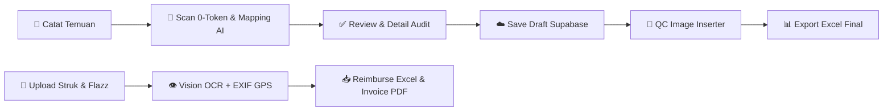

<div align="center">

<!-- CYBERPUNK NEON HERO BANNER -->


<br/>

<a href="#-dua-modul-satu-aplikasi">
  
</a>

<br/>

<!-- NEON CYAN & MAGENTA BADGES -->


<br/>

**Platform internal terpadu untuk Audit Store, Quality Control, dan Reimburse Struk — kini hadir dengan antarmuka `Classic Cyberpunk Neon` (`#00f0ff` Cyan + `#ff007f` Magenta), pemisahan `Scan` (0 token) & `Test` model AI, cache lintas tab/device, serta tampilan murni raw Model ID.**

</div>

---

## ⚡ Highlight Versi Terbaru (`Cyberpunk Neon Edition`)

* 🎨 **Full Classic Cyberpunk Neon UI (`#00f0ff` Cyan + `#ff007f` Magenta/Pink)**
  * Diterapkan merata di **Home Landing (`app.py`)** dan **seluruh 8 halaman (`pages/`)**.
  * Latar *deep void* (`#05050d`) dengan *dual plasma glow* + cyber grid, tipografi **Orbitron** + **Chakra Petch** + **Plus Jakarta Sans** + **JetBrains Mono**, neon glow pada tombol, input, uploader, metrik, sidebar HUD, banner kategori, dan floating controls.
* 🔍 **Pemisahan `Scan` (0 Token) & `Test` Model AI** di `pages/1_Detail_Audit_LLM.py`
  * **`🔍 Scan`** hanya membaca endpoint `GET /models` (**0 token terpakai**) lalu langsung memuat semua model ke dropdown.
  * **`🩺 Test`** menjalankan ping test + ukur latensi per model (persis seperti halaman `Cek Model AI`), lalu menyaring dropdown agar **hanya menampilkan model yang hidup**.
* 🌐 **Shared Cache Lintas Tab & Lintas Device (`@st.cache_resource`)**
  * Hasil **Scan** dan **Test** disimpan di memori server bersama (thread-safe), sehingga ketika dibuka dari **tab baru maupun device lain**, daftar model yang hidup langsung tersedia tanpa membakar token ulang dan tidak ikut terhapus saat tombol *Refresh* di halaman Log ditekan.
* 🏷️ **Pure Raw Model ID**
  * Dropdown menampilkan ID model asli langsung dari server (mis. `deepseek-v4-flash`, `gemini-3.8-flash-high`, `kagiro/claude-sonnet-4-6`) — **tanpa emoji, tanpa prefix provider, dan tanpa label tier `(B-S) [1.4x]`**.

---

## 📦 Dua Modul, Satu Aplikasi

| Modul | Kode Core | Fitur Utama |
|---|---|---|
| 🔍 **Audit & QC Toolkit** | Tanpa prefix (`audit_core.py`, `llm_core.py`, `scoring.py`) | Mapping temuan via Multi-LLM, checklist 130 item, skor berbobot otomatis, foto QC massal unlimited, tanda tangan digital, draft Supabase, & activity log |
| 🧾 **Reimburse Scanner** | Prefix `reim_` (`reim_*.py`) | OCR struk (bensin, parkir, Teazzi) & mutasi Flazz/BCA, lokasi parkir via EXIF GPS, deduplikasi otomatis, Excel kronologis + PDF bukti gabungan lossless |

> [!NOTE]
> Kedua modul berjalan dalam satu aplikasi Streamlit dengan arsitektur core terpisah agar mudah dirawat dan dikembangkan tanpa saling bentrok.

---

## 🗺️ Alur Operasional



---

## 🗂️ Urutan Halaman (Sidebar)

| # | File | Halaman | Fungsi |
|:-:|------|---------|--------|
| 🏠 | `app.py` | ⚡ **Home Launcher** | Landing page Cyberpunk Neon, ringkasan fitur, alur kerja, dan akses cepat seluruh modul |
| 1 | `pages/1_Detail_Audit_LLM.py` | 🤖 **Detail Audit (AI)** | Auto-Scan (0 token) & Test model AI (shared cache lintas device), raw model ID, mapping temuan bebas → 130 checklist |
| 2 | `pages/2_Detail_Audit.py` | 📋 **Detail Audit Manual** | Input checklist manual, skor & grade real-time, floating Save/Download dock, tombol scroll atas/bawah |
| 3 | `pages/3_QC_Image_Inserter.py` | 📸 **QC Image Inserter** | Susun foto QC massal (unlimited baris) + tanda tangan Auditor & PIC ke template Excel |
| 4 | `pages/4_Cek_Model_AI.py` | 🩺 **Cek Model AI** | Diagnostik independen: Auto-Scan `/models` & uji latensi seluruh model (Preset / BYOK) |
| 5 | `pages/5_Reimburse_Scanner.py` | 🧾 **Reimburse Scanner** | OCR struk & Flazz → `Reimburse [Bulan] [Tahun].xlsx` + `Invoice [Bulan] [Tahun].pdf` lossless |
| 6 | `pages/6_Admin_Hapus_Data.py` | 🔐 **Admin Data** | Filter, edit metadata, hapus individual, atau hapus semua draft audit (proteksi password) |
| 7 | `pages/7_Audit_Log.py` | 📝 **Audit Log** | Riwayat Save / Update / Download audit dengan timestamp WIB + hapus log (proteksi password) |
| 8 | `pages/8_Traffic_Log.py` | 📈 **Traffic Log** | Monitoring read-only riwayat pemakaian aplikasi (proteksi password) |
| 9 | `pages/9_Panduan.py` | 📖 **Panduan & Docs** | Dokumentasi interaktif langsung di dalam web + tombol download `DOCS.md` |

> [!TIP]
> Baca panduan lengkap (cara pakai, tambah/hapus provider AI, kustomisasi template, & troubleshooting) di **[DOCS.md](DOCS.md)**.

---

## 🧩 Struktur File

```text
app.py                          Landing page Cyberpunk Neon (launcher)
style.py                        Tema global Classic Cyberpunk Neon (#00f0ff + #ff007f) & utilitas UI
scoring.py                      Rumus skor berbobot (SERVICE 30 / FOOD SAFETY 40 / CLEANLINESS 30) & grade
audit_core.py                   Koneksi Supabase (draft & log) + generator workbook Excel audit
llm_core.py                     Multi-provider LLM, Zero-Token Scan, Ping Test, & shared @st.cache_resource
structure.json                  130 item checklist audit + ETC note
template.xlsx                   Template Excel resmi audit (DETAIL AUDIT + ATTACHMENT)
DOCS.md                         Dokumentasi lengkap All-in-One (penggunaan, provider AI, & troubleshooting)

reim_llm_core.py                Multi-provider Vision LLM untuk OCR reimburse
reim_extract_core.py            Prompt OCR + parser tanggal ID + sorting kronologis + dedup Flazz
reim_excel_core.py              Generator Excel FORM_REIMBURSE + pemulihan logo grouped-shape
reim_pdf_core.py                Penggabung gambar → PDF lossless via img2pdf (tanpa kompresi)
reim_gps_core.py                Ekstraksi EXIF GPS + reverse geocode Nominatim (nama lokasi & alamat)
FORM_REIMBURSE_template.xlsx    Template Excel reimburse

pages/                          9 halaman Streamlit (termasuk 9_Panduan.py interaktif)
presets/                        Preset template Excel QC Image Inserter
.devcontainer/                  Konfigurasi GitHub Codespaces / Dev Container
.streamlit/secrets.toml.example Contoh konfigurasi secrets
.github/workflows/              Keep-alive Supabase
```

---

## 🔌 Provider AI yang Didukung

Semua provider mendukung **Auto-Scan (`GET /models` tanpa token)** dan **Health Test** di `Detail Audit (AI)` maupun `Cek Model AI`. Pada `Reimburse Scanner`, provider muncul otomatis jika API key-nya dikonfigurasi di secrets.

| Provider | Prefix Secret | Detail Audit (AI) | Reimburse Vision |
|----------|---------------|:-----------------:|:----------------:|
| Google Gemini (Direct) | `GEMINI_` | ✅ | ✅ |
| DeepSeek (Direct) | `DEEPSEEK_` | ✅ | ✅ |
| Bandelbanget Proxy | `BANDEL_` | ✅ | ✅ |
| Kagiro Proxy | `KAGIRO_` | ✅ | ✅ |
| 9router Proxy | `ROUTER9_` | ✅ | ✅ (`cbai/deepseek-v4.1-flash`) |
| Kenari Proxy | `KENARI_` | ✅ | ✅ |
| GateAI Proxy | `GATEAI_` | ✅ | ✅ |
| Juan Proxy | `JUAN_` | ✅ | ✅ |
| BYOK (Bring Your Own Key) | Input UI (shared) | ✅ | sesuai model |

> [!TIP]
> Model dengan prefix `cbai/*` (mis. `cbai/deepseek-v4.1-flash`) hanya tersedia pada provider **9router**.

---

## 📄 Hasil Unduhan Reimburse

Nama file mengikuti **bulan & tahun data transaksi** (bukan tanggal hari ini):

* 📊 **Excel** → `Reimburse [Bulan] [Tahun].xlsx` *(contoh: `Reimburse Agustus 2026.xlsx`)*
* 🧾 **PDF** → `Invoice [Bulan] [Tahun].pdf` *(contoh: `Invoice Agustus 2026.pdf`)*

Alur unduhan menggunakan mekanisme 2 tahap: klik **Proses Excel** / **Proses PDF** terlebih dahulu hingga selesai, lalu tombol **Download** akan muncul dengan byte file yang stabil.

---

## 🚀 Setup Lokal

```bash
pip install -r requirements.txt
```

Buat file `.streamlit/secrets.toml` (salin dari `.streamlit/secrets.toml.example`) lalu isi kredensial:

* `SUPABASE_URL`, `SUPABASE_KEY` — database draft audit & traffic log.
* `ADMIN_PASSWORD`, `TRAFFIC_LOG_PASSWORD` — proteksi halaman Admin, Audit Log, dan Traffic Log.
* `<PROVIDER>_API_KEY` *(+ `<PROVIDER>_BASE_URL` bila diperlukan, mis. `ROUTER9_BASE_URL`)* — kredensial provider AI.
* `DEFAULT_NAME`, `DEFAULT_DEPARTMENT`, `DEFAULT_PURPOSE`, `DEFAULT_BANK_ACC` — default data pemohon reimburse.

Jalankan aplikasi:

```bash
streamlit run app.py
```

> [!WARNING]
> Jangan pernah meng-commit `.streamlit/secrets.toml` ke GitHub (sudah dikecualikan di `.gitignore`). Hanya `.streamlit/secrets.toml.example` yang boleh masuk ke repositori.

---

## ☁️ Deploy ke Streamlit Community Cloud

1. Push repositori ini ke GitHub (pastikan tanpa `secrets.toml`).
2. Buat aplikasi baru di Streamlit Community Cloud dengan entrypoint `app.py`.
3. Masukkan seluruh konfigurasi secrets melalui **App → Settings → Secrets**.
4. Untuk keep-alive Supabase via `.github/workflows/keep-alive.yml`, tambahkan repository secrets `SUPABASE_URL` dan `SUPABASE_KEY` di GitHub Actions.

---

<div align="center">


</div>

